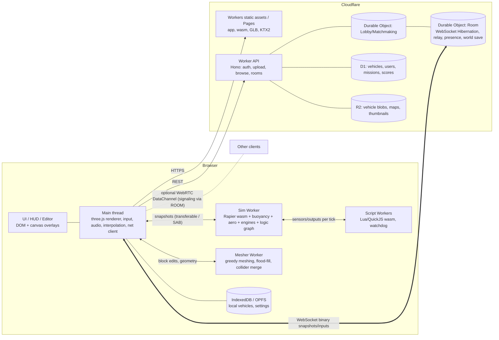

# 19 - Browser Tech Stack Plan (Stormworks-like sandbox on the web)

Date: 2026-11-22. Author: research agent (tech-stack track). Confidence tags: [V] verified against a fetched primary page this session, [S] from search snippets / third-party blogs (verify before committing), [J] my own engineering judgement/estimate.

## 0. TL;DR recommendation

| Layer | Pick | Why (one line) |
|---|---|---|
| Language/build | TypeScript + Vite (multi-file); still emit an optional single-file build via esbuild | Game will be 50-100x larger than Throttle Ridge; needs workers, wasm, code-splitting |
| Rendering | three.js (current r18x; ship on WebGLRenderer first, keep WebGPURenderer/TSL as an opt-in) | Same stack as existing games; best ecosystem; InstancedMesh + custom chunk meshes fit voxel blocks |
| Physics | Rapier (`@dimforge/rapier3d-compat`, later `-deterministic-compat` if lockstep is wanted) in a dedicated Web Worker, behind a thin `PhysicsBackend` interface; evaluate JoltPhysics.js as the alternative for joint-heavy rigs | Small, fast, Rust/wasm, snapshots; interface lets us swap |
| Custom sim | Own fixed-step layer (60 Hz) for buoyancy, aero, engines, logic graph | Not provided by any engine |
| Multiplayer | Host-authoritative rooms; Cloudflare Worker + Durable Object (WebSocket Hibernation API) as lobby/relay/persistence; WebRTC DataChannel optional later | DO WebSockets are cheap and zero-ops; WebTransport not available on Workers |
| Scripting | Lua (wasmoon) or QuickJS-wasm inside a dedicated Worker with a hard-kill watchdog | Genre parity (Stormworks uses Lua) vs. simplicity |
| Storage | IndexedDB locally; D1 (metadata) + R2 (blobs) for sharing; versioned binary/JSON vehicle format, gzip via CompressionStream | Egress-free R2, tiny blobs |
| Hosting | Cloudflare Workers static assets (or Pages) + Worker API + DO + R2 + D1 | User already has the account |

## 1. Context: what the existing repo does

Observed in /home/user/projects:

- `throttle-ridge/`: three.js **0.170.0** + planck.js 1.4.2 (2D Box2D). Source is plain ES modules in `src/js/*.js` (main, physics, render, net, input, storage, audio...), dev-served with an import map pulling three/planck from jsDelivr, then `tools/build.mjs` (esbuild 0.24.2) bundles+minifies and inlines everything into one ~918 KB `index.html`. No TypeScript, no Vite. Has a unit test script (`tools/test.cjs`).
- `cube-assault/`: also a single self-contained `index.html` (~929 KB).
- Multiplayer in throttle-ridge (`src/js/net.js`): up to 4 players over a shared "arcade realtime server" (`rt.js`, a Cloudflare Worker loaded from `noah-and-lars.github.io/projects/rt.js`), rooms as realtime channels with presence, each client simulates only its own bike and sends state 10x/s, others are puppets rendered ~160 ms behind (snapshot interpolation). That is already the "host/owner-authoritative + interpolation" pattern recommended below.
- Conventions to keep: vanilla-ish modules, no framework, offline-capable, runs on iOS Safari/touch, MIT-licensed libs with licence text bundled, version drift check between dev import map and build.

Implication: a vehicle sandbox with wasm physics, workers and shared binary assets outgrows "one inline HTML file" (wasm base64 inlining bloats ~33%, workers must be blob URLs, no caching granularity). Recommend Vite+TS for the new game, but keep the *ethos* (static hosting, no runtime dependencies, offline-capable via service worker) and optionally keep an esbuild "single-file demo" target for the editor-only MVP.

## 2. Rendering

### 2.1 Candidates

**three.js** (recommended)
- Current npm versions seen: r186 published ~2026-09 (r186 notes: WebGPU renderer improvements, native Gaussian splats, removal of legacy build formats/shader exports); npm shows 0.187.0 too [S: cgworld.jp, socket.dev, mind-verse.de]. The repo's 0.170.0 is ~16 releases old; upgrading is mostly painless but pin exact versions (three has breaking changes most releases; r186 removed old build formats).
- WebGPU: `WebGPURenderer` auto-falls back to a WebGL2 backend, and TSL (three shading language) compiles to WGSL or GLSL, so one shader source can run on both [S: three.js manual https://threejs.org/manual/en/webgpurenderer, discourse thread]. Compute shaders need real WebGPU (not available in the WebGL2 fallback) [S]. Third-party blogs call it "production-ready" since ~r171; official docs stay cautious [S]. Browser support: Chrome/Edge default since 2023; Safari 26 shipped WebGPU Sept 2025; Firefox desktop was still partial/flagged in the sources I found [S: utsubo.com migration guide, buildmvpfast.com]. Android/iOS coverage is still uneven.
- Verdict: build the game on **WebGLRenderer + custom GLSL/ShaderMaterial/onBeforeCompile** first (universal, matches the existing games, stable), isolate shaders behind a small material layer, and plan an optional WebGPU/TSL path in a later phase for GPU ocean FFT and large instance counts. Do not make WebGPU a hard requirement.

**Babylon.js** (8.x shipped Mar 2025 with GLSL+WGSL core shaders; 9.0 Mar 2026 reportedly added clustered lighting/frame graph [S]). Pros: batteries included (inspector, node material editor, GUI, built-in Havok physics plugin, mature WebGPU). Cons: bigger bundle, Havok is a wasm blob with licensing of its own, and our team/repo already knows three.js; we would still hand-write the voxel/ocean parts. Good alternative if we wanted less code, not recommended here.

**PlayCanvas**: open-source engine + hosted editor; WebGPU maturity is described inconsistently (dual backend vs WebGL2-first) [S]. Editor-centric workflow fits poorly with a procedural, player-built world. Not recommended.

Source comparisons (directional, vendor-authored): https://www.utsubo.com/blog/threejs-vs-babylonjs-vs-playcanvas-comparison , https://app.cinevva.com/blog/2026-06-09-web-game-engines-2026-comparison

### 2.2 Techniques for this game

- **Vehicle blocks**: Vehicles are small (tens to a few thousand 0.25 m cells) and *dynamic* (moving, damageable, editable). Do not use world-style chunk streaming. Approach: per vehicle (and per rigid sub-assembly), merge visible block faces into **one BufferGeometry per material group** with greedy meshing, rebuilt on edit/damage (rebuild cost for a 2000-block vehicle in a worker is ~1-3 ms [J]). Cull hidden faces between adjacent solid blocks. Non-cube parts (wheels, engines, props, windows) are prefab meshes drawn with `InstancedMesh` keyed by part type, with per-instance color attribute.
- **Editor**: grid + ray-cast picking against an occupancy hash (not three.js raycast on meshes); ghost block preview; mirror symmetry; undo stack. Editor can re-mesh synchronously for small vehicles.
- **Draw calls**: budget <= ~400 per frame. Per vehicle: 1-4 merged meshes + instanced part meshes. Use `BatchedMesh` (three.js) as an option to cover many different part types in one draw call.
- **Shadows**: one cascaded directional light (3 cascades, 2048 map, or CSM addon), only the player's vicinity casts; vehicles' blocks cast, ocean doesn't receive from distant objects. Contact/underwater darkening faked in the ocean shader.
- **Ocean** (large worlds): Phase 2 uses a Gerstner-wave vertex shader on a camera-following, radially-LOD'd grid (e.g. concentric rings, 128 -> 2048 m) with analytic wave functions that the *same* CPU code evaluates for buoyancy (so visuals and physics agree). Foam/shoreline from a depth texture; fresnel + sky reflection from a cubemap; planar refraction faked by screen-space color. Later upgrade: FFT ocean via WebGPU compute (Tessendorf), with GPU readback only for a coarse height tile for physics (readback latency 1-2 frames; keep Gerstner for physics instead). 
- **Terrain/world**: heightmap tiles (e.g. 512 m tiles, 129x129 verts, 3 LODs), generated procedurally in a worker or loaded from R2 as .bin; heightfield collider in physics only near vehicles.
- **Sky/weather**: analytic sky shader, fog, rain as GPU particles/instanced quads.
- **Precision**: large oceans -> floating origin (rebase world when player > ~2-4 km from origin; physics and render rebased together) to avoid float32 jitter.
- **Targets**: 60 fps on integrated GPU (Intel Iris Xe / Apple M1 class) at 1080p with resolution scale 0.75-1.0, 30 fps / DPR 1.5 on phones; <= 1.5M triangles/frame, <= 400 draw calls.

## 3. Physics

### 3.1 Options

| Engine | Package / status | Notes for us |
|---|---|---|
| **Rapier** | `@dimforge/rapier3d-compat` (wasm inlined as base64, bundler-friendly); `@dimforge/rapier3d` (separate .wasm). Latest seen: 0.19.x (0.19.0 ~Sep 2025, `-deterministic` flavor 0.19.3 updated Nov 2025) [S: npm/unpkg/socket.dev; changelog notes contact-heavy scene speedups and a reworked broad-phase] | Rust->wasm, good TS API, joints (revolute, prismatic, fixed, spherical, generic) with motors and limits, multibody (reduced-coordinate) joints, `DynamicRayCastVehicleController`, CCD, `world.takeSnapshot()` (serialize whole world, handy for host migration/late joiners). Standard build is locally deterministic but **not guaranteed cross-platform**; use the separate `-deterministic` package for that (slower, no SIMD) [S: README]. Recommended primary. |
| **JoltPhysics.js** | `jolt-physics` npm, wasm builds incl. `wasm-multithread` and `wasm-compat-multithread` (versions 0.36-0.39 seen, verify) [S: npmjs.com/package/jolt-physics] | Industry-grade solver (Horizon Forbidden West), strong constraint stability with high mass ratios, vehicle constraints (wheeled/tracked), hinge/slider/motor constraints, soft bodies. Multithreaded build needs SharedArrayBuffer -> COOP/COEP. Bigger API surface, Emscripten/WebIDL bindings with manual `Jolt.destroy()` memory mgmt. Best candidate if hinge/rotor/crane/propeller rigs are unstable in Rapier. A Godot-forum comparison found native Rapier faster on 3/5 scenes and Jolt a bit ahead on others (native, not the JS builds) [S] - no reliable JS-build benchmark exists; **we must benchmark ourselves**. |
| Ammo.js (Bullet) | old Emscripten port, large (~1.5-2 MB), mostly unmaintained | Mature features (raycast vehicle, constraints) but heavy and awkward. Not recommended. |
| cannon-es | pure JS | Too slow/unstable for hundreds of compound bodies and joints. No. |
| PhysX wasm | `physx-js-webidl` (PlayCanvas) | Powerful (articulations, vehicles SDK), big binary (~2-3 MB+), complex build. Reasonable fallback; not first choice. |
| Havok (Babylon) | proprietary wasm | Only if using Babylon. |

### 3.2 Modelling vehicles in the engine

- A vehicle = **one rigid body with a compound collider** (one cuboid collider per merged box region; greedy-merge adjacent solid cells into larger boxes to keep collider count in the tens, not thousands) + sub-bodies connected by joints for each moving assembly (wheels/hinged doors/rotors/pistons). Mass, COM and inertia tensor recomputed from the block set on edit (Rapier does this from collider densities; set additional mass properties for engines/fuel).
- Damage/breakage: removing blocks -> flood-fill connectivity on the block graph (in worker) -> split into new bodies; this is the expensive path (budget below).
- Land vehicles: either Rapier's raycast vehicle controller (cheap, stable, arcade-ish) or real wheel bodies on revolute joints with motors (Stormworks-like, more cost and instability). Offer raycast-wheel for MVP.
- Static world: heightfield/trimesh colliders for terrain near vehicles only.
- Stepping: fixed 60 Hz, 2-4 solver iterations default, up to 8 for jointed rigs. Use CCD only for projectiles/fast small bodies.

### 3.3 Performance expectations [J, to benchmark in Phase 0]

- Rapier wasm single-thread: order of ~2,000-5,000 active rigid bodies at 60 Hz on a desktop laptop CPU; with joints and contact-heavy stacking, far fewer. Our scene is mostly *few* bodies (tens of vehicles x 1-20 bodies each) with *many colliders* (hundreds per vehicle), so broad-phase cost is dominated by collider count: keep collider counts per vehicle < ~200 via box merging and use sensors/no collider for decorative blocks.
- Budget: physics <= 4 ms/frame on a mid laptop, <= 8 ms on phone-class hardware (then drop to 30 Hz).
- Spike **Phase 0 benchmark**: 20 vehicles x 300 colliders x 6 joints, ocean contact sensors, on M1/Iris Xe/Pixel-class phone; compare Rapier vs Jolt (single and multithread). Decide before Phase 1 ends.

### 3.4 Workers and SharedArrayBuffer

- Run physics + sim in a **dedicated Web Worker**; main thread does rendering, input, UI, audio. Two transport options:
  1. `postMessage` with transferable `Float32Array` snapshots (positions/quats of all bodies) double-buffered each step. Works everywhere, no special headers. 60 Hz x (1000 bodies x 28 B) = ~1.7 MB/s - trivial. **Recommended default.**
  2. SharedArrayBuffer ring/double buffer with Atomics for zero-copy; also required by Jolt multithread build. Needs cross-origin isolation.
- **COOP/COEP**: send `Cross-Origin-Opener-Policy: same-origin` and `Cross-Origin-Embedder-Policy: require-corp` (or `credentialless`) on the top-level document so `crossOriginIsolated === true` [S: MDN/web.dev https://web.dev/articles/coop-coep]. On Cloudflare Workers static assets / Pages, add a `_headers` file in the asset dir (max 100 rules, 2,000 chars/line; **not applied to responses generated by Worker code**, so if the Worker serves HTML (`run_worker_first`) set the headers in code) [V: https://developers.cloudflare.com/workers/static-assets/headers/ ; Pages: https://developers.cloudflare.com/pages/configuration/headers/]. The docs do not list COOP/COEP explicitly, but `_headers` is generic - test `crossOriginIsolated` in console after deploy [S, unverified].
  - Side effects: every subresource must be same-origin or send CORP/CORS (fonts from Google Fonts, CDN scripts, cross-origin iframes, popup OAuth will break). The existing repo loads rt.js from github.io - under COEP that needs CORS/CORP or must move to our origin. Prefer self-hosting everything.
  - Safari/iOS: SAB supported only when cross-origin isolated; fine but test.
- Recommendation: **do not depend on SAB in MVP**; design worker<->main as message passing, treat SAB/Jolt-threads as a later optimization behind a feature flag.

## 4. Custom simulation layers and the loop

### 4.1 Fixed-timestep loop
- Sim runs at **60 Hz fixed dt = 1/60** in the physics worker (Stormworks itself runs physics at 60 Hz). Accumulator pattern, clamp to <= 4 catch-up steps per frame, then drop time ("spiral of death" guard). Render on main at display rate, interpolating between the last two snapshots (alpha = accumulator/dt) -> smooth on 120/144 Hz displays.
- Order within one tick (all deterministic given inputs):
  1. Apply input/commands (controls, seat inputs, network inputs for owned vehicles).
  2. Logic graph / script tick (30 or 60 Hz, see budget) -> writes actuator outputs.
  3. Compute custom forces: engine torque -> wheels/props, buoyancy, drag, aerodynamic lift/drag per surface, thrusters, wind.
  4. `world.step()`.
  5. Post-step: contact/damage events, block destruction queue, fluid/fuel updates, sensors (GPS, radar, compass) for next tick.
  6. Emit snapshot (transferable buffer) + events.

### 4.2 Buoyancy
- Per-vehicle cached **hull sample points** (voxel-cell centers of "displacing" blocks, downsampled to <= ~64-128 points via cell clustering). Each tick: for each point compute depth below wave height `h(x,z,t)` (same Gerstner function as the shader, analytic, ~10-20 flops per wave x 4 waves), apply force `rho*g*V_cell*submersion_fraction` at the point plus drag along local velocity. 100 points x 10 vehicles x 60 Hz = 60k evaluations/s - negligible (< 0.3 ms). Add added-mass/damping terms for stability. Flooding = compartments (flood-fill) altering mass - batch at 5-10 Hz.
- Cost is dominated by point count; scale point count by vehicle size and LOD by distance (remote vehicles: coarse points, 15 Hz).

### 4.3 Aerodynamics
- Per **surface** (wing/flap/fin/prop blade/ rotor blade) element: local velocity (body vel + angular x r + wind), angle of attack, `Cl(alpha)`, `Cd(alpha)` curve lookup (precomputed 64-entry tables with stall), force at the surface's center of pressure. Typical plane 20-60 surfaces, helicopter blades 10-20 elements per rotor; 100 surfaces x 60 Hz = trivial (~0.1-0.3 ms). Aggregate by merging coplanar adjacent wing blocks into one surface at build time.
- Prop/rotor: momentum-theory thrust + torque from RPM; blade-element only for helicopters in Phase 3.

### 4.4 Logic graph tick
- Stormworks-style node graph (numbers/booleans/composite channels) compiled to a **flat topologically ordered op array** (typed arrays, no allocation); evaluate at 60 Hz (or 30 Hz). 1,000 nodes x 60 Hz ~ 60k ops/s = ~0.05 ms. Memory nodes/delays handled as state slots. Per-vehicle graphs run only when occupied or in range (> 2 km: sleep).

### 4.5 Frame budget (target 16.6 ms @ 60 fps desktop; phone 33 ms)
| Item | Desktop budget | Phone budget |
|---|---|---|
| Physics step (worker) | <= 4 ms | <= 8 ms |
| Custom forces + buoyancy + aero (worker) | <= 1.5 ms | <= 3 ms |
| Logic graphs + scripts (worker/other worker) | <= 1 ms (hard-kill watchdog) | <= 2 ms |
| Mesh rebuilds on damage/edit (worker, amortized) | <= 2 ms/frame average | <= 3 ms |
| Main thread JS (render prep, interpolation, UI) | <= 4 ms | <= 8 ms |
| GPU frame | <= 10 ms | <= 20 ms |
Worker and main thread run in parallel, so the physics worker has its own 16.6 ms; main-thread work + GPU is the render budget.

## 5. Multiplayer

### 5.1 Transport options
- **Cloudflare Durable Objects + WebSockets** (recommended): one DO per server/room; WebSocket Hibernation API (`ctx.acceptWebSocket`) lets the DO sleep without duration charges while idle [V: https://developers.cloudflare.com/durable-objects/best-practices/websockets/]. Facts:
  - Per-connection attachment max 16,384 B (survives hibernation); no hard documented per-DO connection cap ("thousands of clients per instance"); incoming message max 32 MiB; ~1,000 requests/s soft limit per object; CPU 30 s default per invocation (resets each message), 128 MB memory per isolate (Workers limit) [V: https://developers.cloudflare.com/durable-objects/platform/limits/ ; memory figure from Workers limits, [S]].
  - Hibernation is blocked by `setTimeout/setInterval`, alarms, in-flight requests: **a DO that runs a server-side tick loop never hibernates**, so it is billed duration while a room is active (acceptable: rooms are active only when players are present).
  - High-frequency tip from the docs: per-message overhead is significant; batch messages (every 50-100 ms) [V].
  - Pricing (paid plan): 1M requests included + $0.15/M; incoming WebSocket messages are billed at a 20:1 ratio; duration $12.50 per M GB-s (13k GB-s/day free tier); SQLite-backed storage rows read/written billed D1-style [S: https://developers.cloudflare.com/durable-objects/platform/pricing]. Outgoing messages are not request-billed as far as I can tell [S, verify]. Always-on full room estimate: 16 players x 15 msg/s = 240 incoming msg/s -> /20 = 12 billable req/s = ~31M/month = ~$4.7 + duration (128 MB x ~2.6M s = 330k GB-s = ~$4) - roughly **$10/month for a room that is full 24/7**, near zero when idle [J]. 
  - Free-plan access to SQLite-backed DOs exists but sources conflict on limits [S].
- **WebRTC DataChannel** (unreliable/unordered mode = UDP-like, best for snapshots): needs signaling (a DO is perfect) and STUN/TURN (Cloudflare Realtime TURN is available; ~10-20% of peers need relay). P2P mesh doesn't scale beyond ~8 players; star topology (host <-> clients) is fine. Adds NAT complexity; use later as an optimization for latency.
- **WebTransport**: browser side is now Baseline (Safari 26.4 shipped it ~Mar 2026 [S: webrtc.ventures 2026/04, MDN]) but **Cloudflare Workers/DOs do not offer a WebTransport server endpoint** (workerd tracking issue open; no QUIC/HTTP3 server listening support) [S: github.com/cloudflare/workerd issue 6451]. Not viable on this hosting. Revisit later.
- WebSocket head-of-line blocking (TCP) hurts under packet loss; mitigate with snapshot deltas, sequence numbers, and discarding stale snapshots.

### 5.2 Authority model
Physics-heavy vehicle sims with joints, buoyancy and logic are expensive and (without the deterministic build) not cross-platform deterministic, so lockstep is out. Options:
1. **Host-authoritative (recommended MVP)**: one player's browser (the host) runs the full simulation (existing throttle-ridge uses owner-sim of own vehicle). Other clients send inputs (seat controls) and render interpolated snapshots. Zero server CPU cost; DO is relay + room registry + persistence. Cons: host cheating/lag, host leaving -> **host migration** using Rapier `takeSnapshot()` + last full state, or just end/pause the session. Matches Stormworks (listen servers).
2. **Per-owner authority**: each player simulates their own vehicle and publishes its state (like throttle-ridge); collisions between vehicles resolved with kinematic proxies - simple, low-latency feel, easy cheating, bad for shared physical interactions (towing, rescue helicopters winching a boat) - which Stormworks is all about. Use for "free roam / non-interacting" mode only.
3. **Server-authoritative in a DO**: run Rapier wasm inside the DO (Rapier compat wasm is loadable in Workers; unverified at our body counts [J]). Tick via alarm/setInterval at 20-30 Hz is allowed within CPU limits only for light scenes; 128 MB memory and single-threaded 60 Hz step of dozens of vehicles is risky. Possible later for small, "dedicated server" rooms. Not MVP.
4. Dedicated headless server on a VM/container (Cloudflare Containers) is an escape hatch if (3) is needed; same Rapier code runs in Node.

### 5.3 Snapshot interpolation and prediction
- Server/host sends snapshots 15-20 Hz (10 Hz for far vehicles); clients render remote bodies **~100-150 ms in the past** interpolating between two bracketing snapshots (hermite using velocities); extrapolate up to ~200 ms on loss. Local owner's vehicle uses local prediction + reconciliation: client sends inputs with sequence ids, sim host-side; rewinding whole joint-heavy vehicle sims is impractical, so use **soft correction** (blend position/rotation toward authoritative over ~100-200 ms) rather than rollback.
- Time sync: ping/pong in the DO (`ctx.setWebSocketAutoResponse` handles ping without waking [V]); estimate offset via NTP-style exchange.

### 5.4 Bandwidth estimates [J, my calculations]
Rigid-body state quantized: position 3x int32 or 3x float32 relative to a 1 km cell (12 B), orientation smallest-three in 4 B, linear velocity 3x int16 (6 B), angular velocity 3x int16 (6 B) => **28-32 B per body**, plus 1 B id/flags. A vehicle with 500 *blocks* is still 1 rigid body; only independently moving sub-bodies (wheels, hinges, rotors, doors) need state: typical car 5 bodies, boat 1-2, helicopter 3-6 (rotors send angle/RPM only, not full pose: ~4 B). Per-vehicle snapshot ~ 100-200 B.
- Scenario: 16 players, 16 vehicles, avg 6 bodies = ~190 B x 16 = ~3 KB per full snapshot. At 15 Hz = 45 KB/s (~360 kbps) downstream per client (with simple delta + interest management typically halves it). Host upstream to 15 clients = 45 KB/s x 15 = ~675 KB/s (~5.4 Mbps) *if sent directly by the host* - too high for a typical home upload, so relay through the DO still needs the host to upload 45 KB/s once and the DO fan-out (DO egress is not a constraint). **Therefore: host uploads once to the DO; the DO fans out.** Upload 45 KB/s (360 kbps) fine.
- Vehicle spawn/edit: 500 blocks x ~6 B (x,y,z int8/int16, type u8, orientation/color u8) = ~3 KB raw, ~1-1.5 KB gzipped. Even a 5,000-block vehicle is ~15-30 KB: send once reliably over WebSocket (chunked), cache by content hash (client already has it from R2/D1 if shared).
- Damage events: block-destroy lists (vehicle id, block indices as varint deltas) - tens of bytes per event.
- Large-world: interest management by distance (e.g. full rate < 500 m, 5 Hz 500-3000 m, none beyond).
- Weather/world state: tiny (< 100 B at 1 Hz).
- Protocol: binary (DataView/ArrayBuffer), message types with 1-byte tag, batched per tick (one WS frame per 66 ms) to cut Cloudflare per-message cost.
- Mobile data: 16-player room ~45 KB/s ~ 160 MB/hour; acceptable on Wi-Fi, warn on cellular; adaptive rate.

## 6. Scripting sandbox (player code, logic microcontrollers)

Requirements: untrusted code, deterministic-ish, time- and memory-limited, can't touch DOM/network, runs per vehicle microcontroller (Stormworks: Lua, 63-ish ms per tick limit etc.).

| Option | Pros | Cons |
|---|---|---|
| **QuickJS compiled to wasm** (`quickjs-emscripten`, also `@jitl/quickjs-*` variants) | Small (~0.5-1 MB), ES2020+, per-runtime `setMemoryLimit`, `setMaxStackSize`, and an **interrupt handler** callback for CPU time limits; documented to run in browsers and Cloudflare Workers; can run multiple contexts per runtime but limits are per runtime [V/S: https://github.com/justjake/quickjs-emscripten and README]. Handle-disposal pitfalls (leaks). Per-context interrupt is an open issue. | Players must write JS, not Lua. |
| **Lua via wasmoon** (real Lua 5.4 in wasm) or **fengari** (Lua 5.3 in pure JS) | Genre parity (Stormworks players know Lua; existing scripts/snippets port easily) | I did not verify their limit APIs [unverified]. In real Lua `debug.sethook` with a count gives an instruction budget; in wasmoon check if `debug` library is exposed. fengari is slower (JS-implemented VM) but needs no wasm. |
| `<iframe sandbox>` / `new Function` / `ShadowRealm` | Easy | Not safe against infinite loops or prototype tricks; no. |
| Visual-only node graph (no scripting) | Simplest, safest | Less expressive than Stormworks' Lua microcontrollers. Ship first. |

Recommended design:
- Phase 1-3: node-graph logic only (section 4.4), compiled to typed ops. No sandbox risk.
- Phase 5: scripts in a **dedicated Web Worker per vehicle (or one pool worker)**, running a Lua (wasmoon) or QuickJS VM; the sim worker sends sensor inputs and receives outputs via SAB or postMessage once per tick. Enforce: (a) VM-level instruction/interrupt budget per tick, (b) memory limit (e.g. 4-8 MB), (c) **watchdog**: if no reply within budget (e.g. 8 ms) the sim keeps last outputs and, after N misses, `worker.terminate()`s and restarts the script (hard kill defeats any VM escape/infinite loop). Messages carry only numbers/booleans/short strings. No imports, no `fetch`, no `eval` of host-created functions; expose a tiny API (`input.getNumber`, `output.setNumber`, `screen.*` draw calls into a command buffer).
- Cheat/abuse: scripts execute on the vehicle owner's client (host-authoritative), so scripting is not a server risk; ownership transfers vehicle + script together.
- Server-side validation of shared vehicles: scan for oversize scripts (size cap ~64 KB) when uploading to R2/D1.

## 7. Storage

### 7.1 Local
- **IndexedDB** (via `idb` or hand-rolled, as throttle-ridge `storage.js` does) for vehicle library, settings, autosaves; Origin Private File System (OPFS) for large binary blobs if needed. Request `navigator.storage.persist()`; always wrap in try/catch (private windows, quota). Export/import vehicle as `.vehicle` file (download/upload) for sharing without a server.

### 7.2 Shared
- **R2** for vehicle blobs/screenshots/world maps (S3-compatible; **no egress fees**; free tier 10 GB-month storage, 1M Class A + 10M Class B ops per month [S: https://developers.cloudflare.com/r2/pricing/]); keyed by content hash (`vehicles/<sha256>.bin.gz`) -> immutable, cacheable at the CDN edge.
- **D1** (SQLite) for metadata: vehicles(id, owner, name, tags, hash, created, block_count, downloads, votes), users, missions, leaderboards; D1 free tier ~5 GB, 5M reads/day, 100k writes/day, paid ~$0.75/GB-month, $0.001/M reads, $1/M writes [S - inconsistent pages, verify].
- Auth: anonymous device ID first, then Sign in via passkeys/OAuth (Workers + Turnstile for upload spam control).
- Durable Object SQLite storage for per-server persistent world state (savegames) if hosted rooms persist.

### 7.3 Vehicle file format
- Versioned **container**: `{magic "SWV1", version u16, header JSON (name, author, thumbnail ref, stats), palette, parts table, blocks chunk, joints chunk, logic chunk, script chunk}`.
- Blocks: dense list of `(x:i16,y:i16,z:i16, type:u16 index into a string->id table stored in header, orientation:u8 (24 rotations), color:u8 palette idx, state:u8)` ~ 10 B each pre-compression; group into 16^3 chunks with RLE for dense hulls; gzip with `CompressionStream('gzip')` (browser-native, no library). Typical 1-3k block vehicle: 5-20 KB.
- Joints/connectors/logic nodes/scripts in JSON-in-binary sections (easy to evolve); always store the **block type names** not numeric ids, mapped through the header table, so adding parts never breaks old saves. Include `minGameVersion` and migrations (`v1 -> v2` functions), plus a JSON export for debugging/diffing and git-friendly mod sharing.
- Validate on load: max blocks (e.g. 20k), max dimensions, max script size, reject NaN, clamp. 

## 8. Build tooling, assets, input, targets

### 8.1 Vite+TS vs single-file
- Existing approach (ES modules + esbuild inlining to one HTML, import map to jsDelivr in dev) is excellent for small 2D-physics games. For this project:
  - Multiple Web Workers (physics, mesher, scripts) -> Vite's `new Worker(new URL('./x.ts', import.meta.url), {type:'module'})`.
  - wasm assets, code-splitting (editor vs play), HMR, TypeScript for a 50k+ LOC codebase with shared types across client / DO / worker, and `vitest` for sim unit tests (the logic graph, buoyancy and netcode are highly testable headless in Node).
  - Cloudflare integration: the official **Cloudflare Vite plugin** (`@cloudflare/vite-plugin`) runs Workers/DOs locally in `workerd` with `vite dev` and deploys with `wrangler` as one project [S: Cloudflare docs; see skill docs "workers-development"]; monorepo: `/client`, `/worker` (API + DO), `/shared` (protocol types, vehicle format, sim core) with pnpm workspaces.
- Keep a `npm run build:single` esbuild target for a downloadable offline edition (use `rapier3d-compat` base64 wasm; blob-URL workers).
- Pin dependency versions (three, rapier) in `package.json` and verify like the existing drift check; vendor licences into `THIRD_PARTY_LICENSES.txt`.

### 8.2 Asset pipeline
- Mostly **procedural**: blocks = generated geometry + atlas/texture array (KTX2/Basis for GPU compression via `KTX2Loader`; 512 px tile atlas, mipmaps), part meshes as GLB (Draco/meshopt compressed, via `gltf-transform` in CI), audio as Opus/OGG (+AAC fallback for Safari) with Web Audio API, procedural engine sounds via granular/loop crossfade by RPM. Fonts: self-host WOFF2 (COEP-safe). Service worker (Workbox or hand-written) precaches app shell + wasm; assets cached by hash; R2 for large optional packs (maps).
- Compressed delivery: Cloudflare serves brotli automatically.

### 8.3 Input: mobile/touch and gamepad
- Gamepad API (`navigator.getGamepads()`, polled per frame; standard mapping; deadzones; rumble via `vibrationActuator` where available), keyboard, mouse (pointer lock for build camera/first person), touch: virtual dual sticks + throttle slider + context buttons (re-use throttle-ridge `input.js` touch layer patterns), seat control layout per vehicle type. Editor on touch: pinch/pan, long-press place, tool bar; tablets are viable, phones are for *playing/piloting* shared vehicles more than building. Prevent iOS gesture conflicts (`touch-action:none`), safe-area insets, PWA manifest + "Add to Home Screen" fullscreen (already done in throttle-ridge).
- Accessibility: remappable keys, UI scale.

### 8.4 Target hardware / performance budgets
- Tier A (primary): 2020+ laptop, Intel Iris Xe/M1, 8 GB RAM, Chrome/Edge/Firefox/Safari current: 60 fps @1080p, 10-20 vehicles in view, 2k-block vehicles.
- Tier B: flagship phones/tablets (A15+/Snapdragon 8 Gen 1+): 30 fps, shadows reduced, resolution scale 0.7, 4-8 vehicles.
- Tier C: low-end: editor + single vehicle, simplified ocean.
- Budgets: initial download <= 3 MB gz (app shell + physics wasm ~0.5-1 MB gz), lazy load the rest; JS heap <= 500 MB desktop / 250 MB phone; texture memory <= 256 MB; <= 400 draw calls; <= 1.5M tris; GC pressure: preallocated typed arrays, no per-frame allocations in sim loops; automatic quality governor (dynamic resolution scale from frame time).
- Telemetry: in-game perf overlay (ms for physics/forces/logic/render), `PerformanceObserver` long-task logging, Cloudflare Web Analytics.

## 9. Architecture (mermaid)



Authority flow (MVP): Host client Sim Worker -> snapshot -> Host main -> WS -> Room DO -> fan-out -> client mains (interpolate ~120 ms behind). Client inputs -> Room DO -> Host.

## 10. Module breakdown (monorepo)

```
/shared
  vehicle-format/   binary+JSON schema, migrations, validators (also used by Worker)
  protocol/         message ids, binary codecs, snapshot quantization
  sim-core/         pure TS: logic graph VM, buoyancy, aero, engine models, wave function (no DOM; tested in vitest/Node)
  blocks/           block/part definitions (data-driven JSON/TS), materials, stats
/client
  render/           three.js scene, vehicle mesh builder, ocean, terrain, sky, particles, post
  editor/           grid, placement tools, symmetry, undo, wiring/logic editor, stats panel
  sim-host/         worker entry: Rapier wrapper (PhysicsBackend), world, vehicle assembly, damage
  mesher/           worker: greedy meshing, flood-fill, collider merging
  script-host/      worker pool: Lua/QuickJS, sandbox API, watchdog
  net/              WS client, snapshot buffer, interpolation, host migration, prediction smoothing
  input/            keyboard, gamepad, touch, seat control maps
  ui/               HUD, menus, vehicle browser, settings (DOM; small framework or Preact)
  audio/            engine/ocean/wind/impact synthesis, spatial audio
  storage/          IndexedDB, import/export, sync client
  game/             modes: sandbox, missions, economy, rescue
/worker
  api/              Hono routes: auth, vehicles, scores, missions
  room-do/          Room Durable Object (hibernating WS, relay, persistence)
  lobby-do/         matchmaking, room registry
  wrangler.jsonc    bindings: D1, R2, DOs, static assets
/tools              asset pipeline (gltf-transform, KTX2), perf benchmarks, e2e (Playwright)
```

Key interfaces: `PhysicsBackend` (createBody, addCollider, addJoint, step, raycast, snapshot) so Rapier/Jolt are swappable; `VehicleModel` (block grid -> bodies/joints/surfaces/points); `SimState` snapshot ABI shared by renderer and net.

## 11. Phased MVP roadmap

**Phase 0 - Spikes (2-3 weeks)**: benchmark Rapier vs Jolt on the target scene (compound colliders, hinge/motor stability, 20 vehicles, phone), prove worker snapshot pipeline, greedy mesher, three.js on WebGL2; set `_headers`/COOP-COEP test deploy on Workers static assets; Vite+TS+Cloudflare plugin skeleton. Exit: decision doc + 60 fps proof.

**Phase 1 - Editor + land vehicle on terrain (6-8 wks)**: block grid editor (place/delete/paint/mirror/undo), block set (frame, wheels, engine, seat, fuel, battery), vehicle assembly -> rigid body + raycast wheels, engine/drivetrain model, heightmap terrain, third-person/chase cam, keyboard+gamepad+touch, IndexedDB save/load + file export. Exit: build car, drive on hills, save.

**Phase 2 - Water and boats (4-6 wks)**: Gerstner ocean (shader + CPU shared function), buoyancy points, propellers/rudders/hull drag, flooding basic, shoreline/foam, floating-origin, day/night + sky. Exit: build boat in ocean, waves of varying sea state.

**Phase 3 - Aircraft (6-8 wks)**: aerodynamic surfaces, control surfaces, propeller/jet engines, helicopter rotors, stall, wind; joints (hinges/pistons) for gear/flaps, logic graph (v1) for autopilot-ish behaviour, camera modes, damage (block destruction + split bodies). Exit: fly plane and helicopter.

**Phase 4 - Multiplayer (6-8 wks)**: Room DO relay, lobby, binary protocol, host-authoritative sim, snapshot interpolation, interest management, voice-free text chat, host migration/rejoin, per-vehicle ownership/seat sharing, anti-abuse (rate limits, size caps), co-op rescue/towing. Optional WebRTC later. Exit: 8-16 players on one ocean.

**Phase 5 - Missions/economy/scripting (6-10 wks)**: mission framework (rescue, delivery, fire), money/research tree, scripts sandbox (Lua/QuickJS + watchdog) with microcontroller screens, weather events (storms, waves up), NPCs (basic), persistence of worlds in DO SQLite, achievements.

**Phase 6 - Sharing and polish (ongoing)**: D1/R2 workshop (upload, browse, rate, remix), moderation, thumbnails, WebGPU/TSL upgrade (FFT ocean, GPU particles), performance governor, PWA/offline, localization, accessibility, mod/API.

Risk register: (1) joint stability under large mass ratios (mitigate: benchmark Jolt, use fixed-constraint merging, substeps); (2) mobile perf (quality governor, 30 Hz sim); (3) host-authority cheating/latency (acceptable for co-op; add validation later); (4) COOP/COEP breaking third-party content (self-host everything, don't require SAB); (5) DO cost spikes (batch frames, hibernation, rate caps); (6) three.js churn (pin versions, adapter layer).

## 12. Sources

- three.js WebGPURenderer manual: https://threejs.org/manual/en/webgpurenderer
- three.js WebGPU migration (third-party): https://www.utsubo.com/blog/webgpu-threejs-migration-guide , https://www.buildmvpfast.com/blog/threejs-webgl-to-webgpu-renderer-migration-2026 , https://discourse.threejs.org/t/webgpurenderer-forcewebgl-true-vs-webglrenderer/87805/2
- three.js releases: https://github.com/mrdoob/three.js/releases ; r186 news https://cgworld.jp/flashnews/01-202610-Threejs-r186.html ; npm 0.187.0 https://socket.dev/npm/package/three/overview/0.187.0
- Engine comparisons: https://www.utsubo.com/blog/threejs-vs-babylonjs-vs-playcanvas-comparison , https://app.cinevva.com/blog/2026-06-09-web-game-engines-2026-comparison
- Rapier JS: https://github.com/dimforge/rapier.js ; deterministic README https://cdn.jsdelivr.net/npm/@dimforge/rapier3d-deterministic@0.19.3/README.md ; https://socket.dev/npm/package/@dimforge/rapier3d-deterministic
- JoltPhysics.js: https://npmjs.com/package/jolt-physics ; https://github.com/jrouwe/JoltPhysics.js ; Godot physics comparison https://forum.godotengine.org/t/physics-engine-comparison-rapier-vs-godot-vs-box2d-3d-vs-jolt/142786
- Cloudflare DO limits: https://developers.cloudflare.com/durable-objects/platform/limits/ ; pricing: https://developers.cloudflare.com/durable-objects/platform/pricing ; WebSockets/hibernation: https://developers.cloudflare.com/durable-objects/best-practices/websockets/
- Cloudflare static asset headers: https://developers.cloudflare.com/workers/static-assets/headers/ ; Pages headers: https://developers.cloudflare.com/pages/configuration/headers/
- COOP/COEP: https://web.dev/articles/coop-coep ; MDN https://developer.mozilla.org/docs/Web/HTTP/Reference/Headers/Cross-Origin-Embedder-Policy
- WebTransport baseline: https://webrtc.ventures/2026/04/webtransport-is-now-baseline-what-it-means-for-real-time-media/ ; MDN https://developer.mozilla.org/docs/Web/API/WebTransport_API ; workerd issue https://github.com/cloudflare/workerd/issues/6451
- quickjs-emscripten: https://github.com/justjake/quickjs-emscripten ; https://www.npmjs.com/package/quickjs-emscripten
- R2 pricing: https://developers.cloudflare.com/r2/pricing/
- Local repo: /home/user/projects/throttle-ridge (README.md, tools/package.json, tools/build.mjs, src/js/net.js), /home/user/projects/cube-assault

## 13. Open items to verify before committing
1. Rapier vs Jolt benchmark on our scene (no trustworthy JS-build comparison exists).
2. That `_headers` COOP/COEP are honored on Workers static assets (test deploy).
3. wasmoon/fengari instruction-limit/hook support and memory caps (not verified).
4. Rapier wasm inside a Durable Object under CPU/memory limits (only needed for server-authoritative option).
5. Exact current versions of three (r186/0.187?), Rapier (0.19.x), Jolt (0.36-0.39?) - check npm on the day of scaffolding.
6. DO outgoing WebSocket message billing and Free-plan DO limits (sources conflicted).
